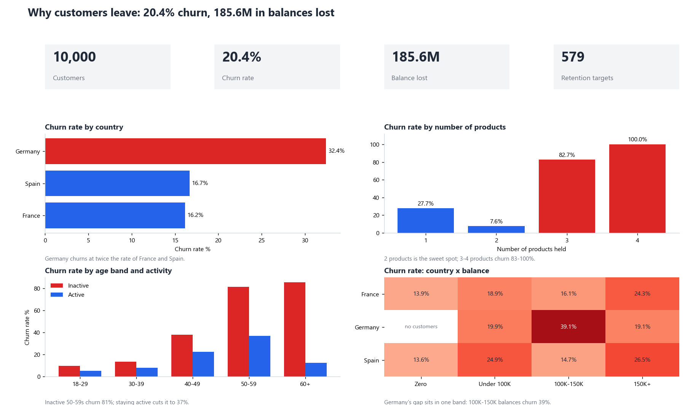

# Bank Customer Churn Analysis — SQL + Power BI

Why do 1 in 5 customers leave this bank, and who should the retention team call first?
10,000 customers, two raw tables (one of them messy), cleaned and modelled in **SQL**,
answered with 8 business queries, and presented as a **Power BI** dashboard.



## Key findings

| # | Finding | Evidence (query) |
|---|---|---|
| 1 | **20.4% of customers churned, taking 185.6M in balances.** | Q1 |
| 2 | **Germany churns at 32.4%, twice France (16.2%) and Spain (16.7%)**, and accounts for 52.8% of all balance lost with only 25% of customers. | Q2 |
| 3 | **Germany's gap is not spread evenly.** The obvious explanation — Germany has no zero-balance customers, who churn least — is wrong: in the under-100K and 150K+ bands Germany is in line with other countries. The gap sits in one band: **100K–150K balances churn 39.1% in Germany vs 16.1% (France) and 14.7% (Spain)**, and that band holds 1,652 German customers. | Q3 |
| 4 | **Two products is the sweet spot (7.6% churn).** One product churns 27.7%; three products 82.7%; four products 100%. Pushing a third product looks like it drives customers away, not in. | Q4 |
| 5 | **Age and inactivity together drive churn.** Inactive customers aged 50–59 churn 81.2%; the active ones 37.1%. Over 60, inactive 85.6% vs active 12.5%. | Q5 |
| 6 | **Credit score does not predict churn** (18.6%–22.0% across every band), so it should not be used to target retention. | Q6 |
| 7 | **Retention list:** 579 customers still with the bank match the riskiest pattern (inactive, aged 40–59, non-zero balance), holding **69.5M** in balances. | Q8 |

## Recommendations

1. Start retention calls with the 579 customers in finding 7; re-engaging an inactive customer is the lever the data supports most strongly.
2. Investigate German customers with 100K–150K balances specifically (pricing, a competitor offer, or a service issue) rather than "Germany" as a whole.
3. Review how third and fourth products are sold; at 83–100% churn they should be treated as a warning sign, not a cross-sell success.

## Data cleaning (recorded in `data_quality_log`)

| Problem found | Rows | What was done |
|---|---|---|
| Exact duplicate customer row | 1 | Kept one row per customer (`ROW_NUMBER()`) |
| Country written as `FRA` / `French` | 3,274 | Mapped to `France` |
| Missing surname | 3 | Set to `Unknown` |
| Missing age | 3 | Left empty, shown as age band `Unknown` (not guessed) |
| Salary stored as `-999999` | 3 | Treated as missing |

## How it works

```
data/raw/*.csv ──► SQLite ──► sql/01_clean_and_model.sql ──► customers, accounts, churn_base view
                              sql/02_analysis.sql        ──► 8 business questions (printed to analysis_output.md)
                              data/model/*.csv           ──► Power BI (measures in powerbi/measures.dax)
```

SQL used: CTEs, `ROW_NUMBER()`, `DENSE_RANK()`, `SUM() OVER ()` for shares of total, `CASE` banding,
conditional aggregation, joins and views.

## Run it

```bash
pip install pandas matplotlib tabulate
python run_pipeline.py      # builds bank_churn.db, prints every answer, exports data/model/
python make_preview.py      # redraws images/dashboard_preview.png
```

Power BI: follow [powerbi/BUILD_GUIDE.md](powerbi/BUILD_GUIDE.md).

## Data

Public "Bank Customer Churn" dataset (10,000 customers of a European bank; Kaggle "Churn Modelling",
multi-table version from Maven Analytics). Balances are in the dataset's own currency, which the source does not state.
`account_info.csv` is the account columns of the published dataset; `customer_info.csv` is the messy customer table as published.
